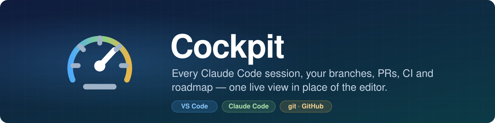
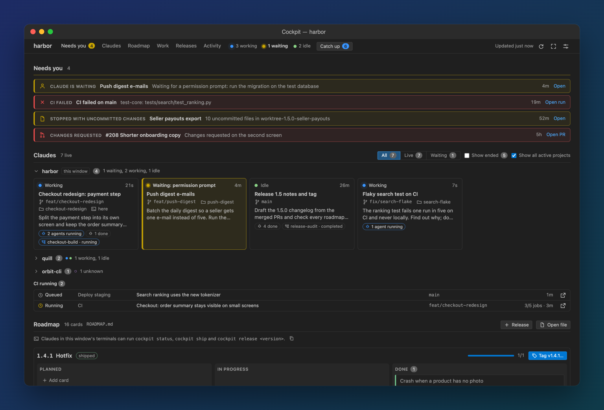
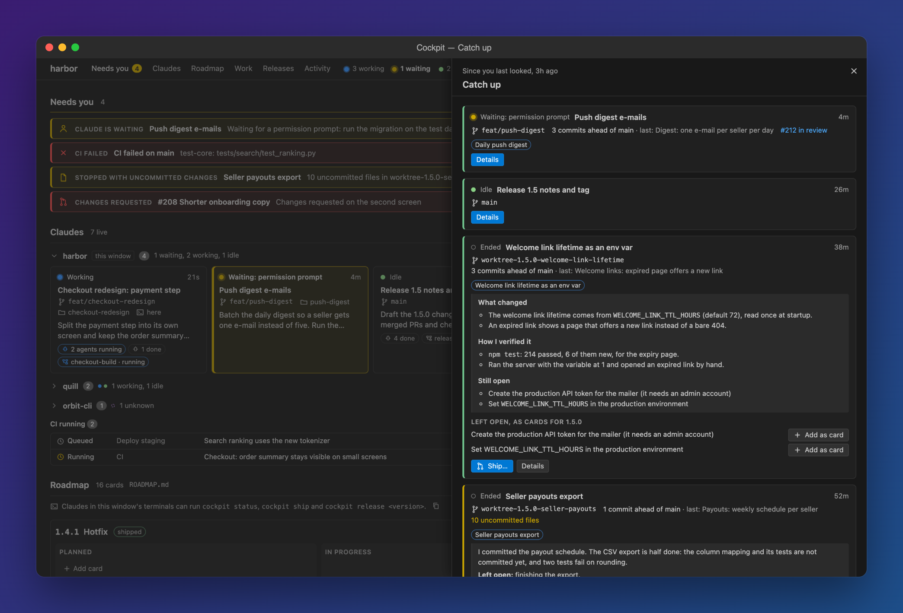
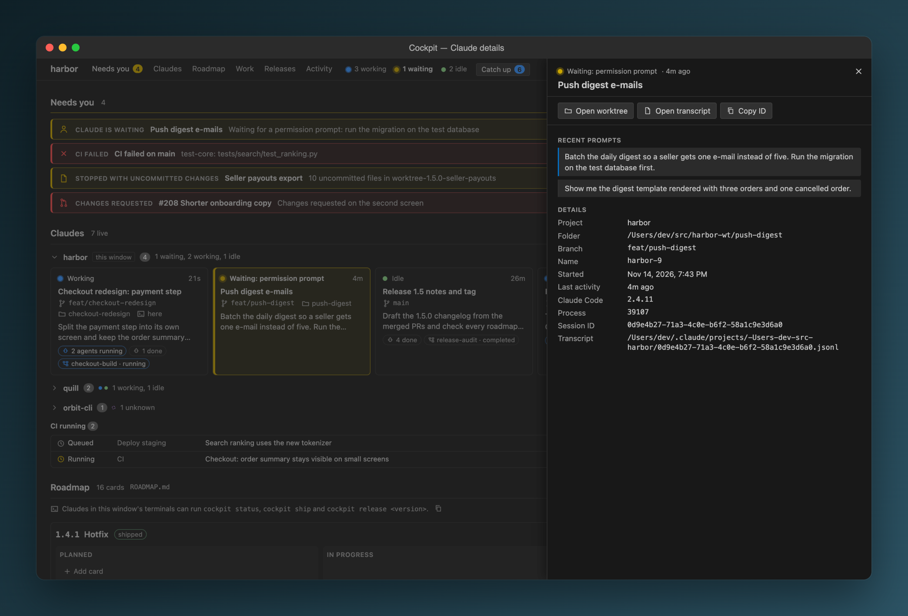
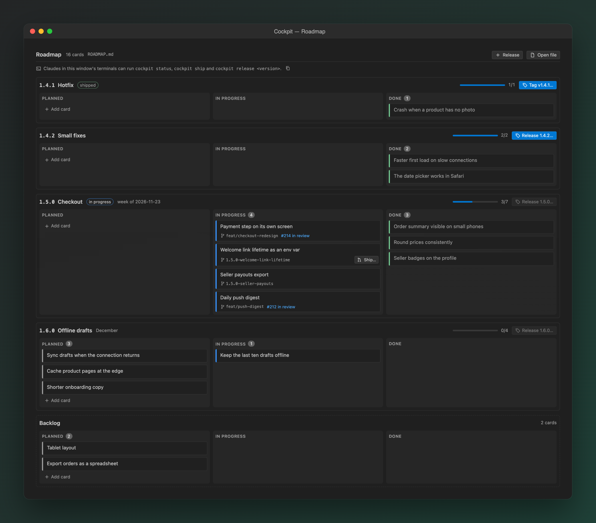
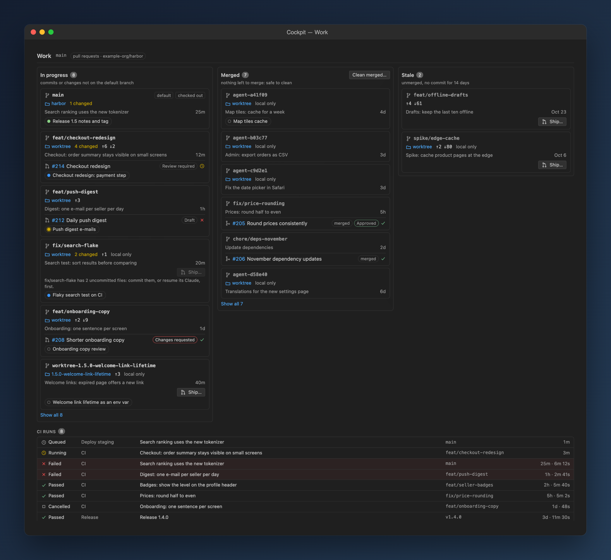
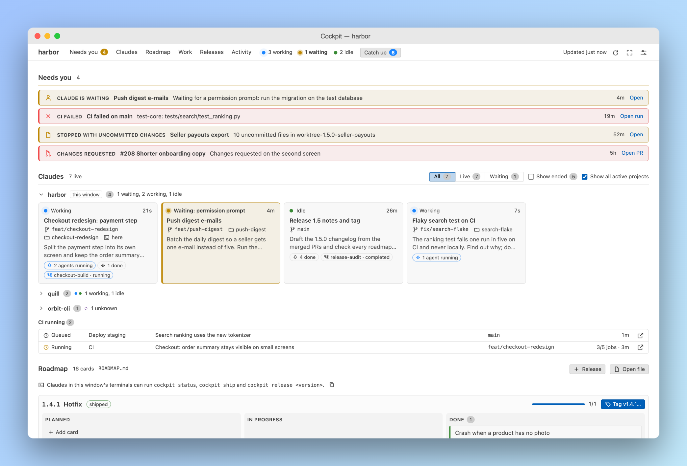

  

  
  
  
  
  

  <b>Running five Claudes at once? Cockpit tells you which one needs you, what each one finished, 
  and ships their branches — without leaving VS Code.</b>

  <a href="#quick-start">Quick start</a> ·
  <a href="#whats-on-the-page">Features</a> ·
  <a href="#delivery-ship-and-release">Ship &amp; release</a> ·
  <a href="#the-cockpit-command">The <code>cockpit</code> command</a> ·
  <a href="#settings">Settings</a> ·
  <a href="#development">Development</a>

## Why

Claude Code makes it easy to have several sessions going at once — in worktrees, in terminals, across projects. Keeping
track of them is the hard part: which one is stuck on a permission prompt, which one finished an hour ago with
uncommitted files, which branch is ready to merge, and whether CI on `main` just went red.

Cockpit is a VS Code tab that answers all of that at a glance. It reads Claude Code's local session files, your git
repository and (optionally) GitHub through `gh`, and turns them into one live page — with the actions to act on it.

## Highlights

|  |  |
| :-- | :-- |
| 🚨 **Needs you** — Claudes waiting on a prompt, red CI on `main`, PRs with changes requested, stopped work with uncommitted files. | 🤖 **Claudes** — a live card per session across every project: status, branch, last prompt, subagents and workflow runs. |
| 📬 **Catch up** — what each Claude finished since you last looked, with its report and the one next action (Ship, Resume, Open PR). | 🗺️ **Roadmap** — a drag-and-drop kanban backed by a plain Markdown file, with a lane per release. Start a Claude on any card. |
| 🌿 **Work** — branches and worktrees as a board (In progress / Merged / Stale), PR and check status, safe **Clean merged…**. | 🚀 **Ship & release** — merge, open PRs, bump versions, date the changelog and tag, locally or via GitHub, always after a confirmation. |

## Screenshots

<table>
  <tr>
    <td width="50%"> <b>Catch up</b> — each finished Claude's report, its branch and the next action.</td>
    <td width="50%"> <b>Session details</b> — recent prompts, folder, branch, transcript; resume or focus its terminal.</td>
  </tr>
  <tr>
    <td width="50%"> <b>Roadmap</b> — lanes per release, cards linked to branches and PRs, Release and Tag buttons.</td>
    <td width="50%"> <b>Work</b> — branches, worktrees, PRs and CI runs, with what is safe to clean.</td>
  </tr>
  <tr>
    <td colspan="2"> Follows your VS Code theme — here in Light Modern.</td>
  </tr>
</table>

Screenshots use the built-in sample data of the browser preview (<code>dist/dev.html</code>); see <a href="#development">Development</a>.

## Quick start

1. Download `cockpit-<version>.vsix` from the [latest release](https://github.com/rafa-rrayes/cockpit/releases/latest)
   (or [build it yourself](#build-and-install)).
2. Install it: `code --install-extension cockpit-<version>.vsix`, then reload the window.
3. Open a git repository and run **Cockpit: Open** — or click the gauge icon in the activity bar.

Requirements: VS Code 1.100+, `git` on the PATH, and [Claude Code](https://claude.com/claude-code) sessions on this
machine. The [GitHub CLI](https://cli.github.com) (`gh`, logged in) is optional and adds pull requests and CI.

## What's on the page

Cockpit takes over the editor area with a live, interactive overview of the project and of every Claude Code session
on this machine:

- **Needs you**: Claudes waiting on a permission prompt or a question, a failed CI run on the default branch,
  pull requests with changes requested, and a Claude that stopped (idle or ended) with uncommitted files in its
  worktree. The count also shows on the status-bar item and the activity-bar icon.
- **Catch up** (top bar, with a count): what changed since you last closed it. Each Claude of this project that
  finished or is waiting, newest first, one per branch: its branch, how many commits ahead and the last subject, the
  uncommitted files, its pull request, its roadmap cards and its last answer (the report), with one next action:
  **Ship…**, **Resume**, **Focus terminal**, **Open #n** or **Details**. Then the pull requests whose checks passed or
  failed, or that merged (**Pull main**). Closing it counts all of it as seen, except a Claude whose
  branch is still to ship or whose uncommitted work is still to resume: those stay until it is done; the first time, it covers the last
  day. Under a report's "still open" list, **Add as card** puts an item in the session's lane.
- **Claudes**: one card per session (busy, waiting, idle, or ended in the last days), grouped by project with this
  window's project first. Each card shows the title, branch, last prompt, subagents and workflow runs. Click a card
  for the details: recent prompts, workflow phases, subagents, and the actions **Resume** (a new terminal running
  `claude --resume <id>` in the session's folder), **Focus terminal** (when it runs in a terminal of this window),
  **Open worktree**, **Open transcript** and **Copy ID**.
- **Work**: branches and worktrees as a board (In progress, Merged, Stale) with uncommitted files, ahead/behind,
  the pull request and its checks, and the Claudes working there. Below that, the latest CI runs. The header shows
  how this repository delivers (`direct · local`, `direct · origin` or `pull requests · owner/repo`, see
  [Delivery](#delivery-ship-and-release)), and a branch with commits that cannot be finished yet keeps its button,
  disabled, with the reason under it.
  **Clean merged…** lists the merged worktrees and branches it would remove and does nothing until you confirm.
  It leaves out anything a live Claude or a running subagent works in, a locked worktree, and a folder open in
  any VS Code window. After you confirm it checks again, then for each branch verifies with
  `git merge-base --is-ancestor` that its commits are all in the default branch (local or `origin` copy), runs
  `git worktree remove` (never `--force`, so a worktree with uncommitted or untracked files is kept; ignored files
  such as `node_modules` go with it), and deletes the branch with `git branch -D`, which is safe once verified and
  works for a branch merged on GitHub but not pulled yet. Squash-merged branches are left to you: git cannot
  confirm them. It reports what it kept and why.
- **Roadmap**: a board you edit in place, with a lane for each planned release plus a Backlog, and the columns
  Planned, In progress and Done. Drag a card sideways to change its status, or to another lane to move it to
  another release. Each card's menu does the same without dragging, and also renames and deletes. **Add card**
  sits under each lane's Planned column, and **Release** adds a lane. A lane's header shows how many of its cards
  are done. The board is a plain file, `.cockpit/roadmap.md` (see [The `.cockpit/` folder](#the-cockpit-folder)):
  every edit changes only its own lines in that file, through VS Code's editor, so undo works there and the file
  stays one you (and any Claude) can edit by hand. With no board yet, the section offers to create one.
  **Start Claude…**, in a card's right-click menu, opens a terminal running `claude` on that card. Cmd-click
  (Ctrl-click) selects more cards, in any lane, to start one Claude on them as a batch. The launcher picks the model
  and the thinking effort (low to max); drag the thinking slider down, or click the handle under it, for a second
  slider with up to 8 subagents, and pull that one down for the model every subagent runs on (Auto leaves it to
  Claude Code; a model is forced with `CLAUDE_CODE_SUBAGENT_MODEL` and `CLAUDE_CODE_SUBAGENT_MODEL_FORCE`). The Claude gets a standard
  prompt (follow CLAUDE.md and the lessons, keep the change small, prove it with the tests, update the changelog,
  commit on its branch, and ship or release through the `cockpit` command, not by hand with git), runs in a
  worktree of its own unless you untick it, and its planned cards
  move to In progress. The worktree is named after the lane and the card (`1.5.0-welcome-link-lifetime`,
  `backlog-tablet-layout`), Claude Code makes its branch `worktree-<name>`, and the cards are linked to that branch:
  each shows the branch and its pull request, and, once the branch can be finished, the button that finishes it.
- **Ship, release, tag** (see [Delivery](#delivery-ship-and-release)): a finished branch gets **Merge into main…**
  or **Ship…** (in Work, in Catch up and on its card), and a lane whose cards are all done gets **Release X…**.
  What they do follows the repository: with no remote they merge, commit and tag here; with an `origin` they go
  through pull requests. Each asks first, in a dialog that shows what it will do.
- **For Claudes too**: the [`cockpit` command](#the-cockpit-command), in every terminal of the window, runs the
  same actions, so a Claude can finish its own work when you ask it to.
- **Releases**: the current version, the latest tag and the commits since it, and the changelog's Unreleased
  lines.
- **Activity**: commits, session starts and ends, CI runs and pull requests, newest first.

Cockpit only reads, except when you act: **Clean merged…**; the roadmap board, which writes its own file; and the
finish, **Release…**, **Tag…** and **Pull** actions, which change git (and GitHub) after a confirmation. **Start
Claude…** only opens a terminal: the Claude in it works under its own permission prompts. A Claude's last answer
goes into a pull request's body only when you Ship; otherwise transcripts never leave the machine. The network
calls are `gh` commands, made with your existing GitHub CLI login, and the `git fetch`/`push`/`pull` of those
actions, to `origin`.

## The `.cockpit/` folder

Cockpit keeps its own files in `.cockpit/`, at the top of the main checkout:

    .cockpit/
      .gitignore     "*": everything here stays out of git (written once; edit it to share the board)
      roadmap.md     the board
      config.json    optional: { "roadmap": "ROADMAP.md", "delivery": "auto" }
      inbox/         requests of the cockpit command

The board is untracked, so it never shows up in `git status` and never stands in the way of a merge or a pull.
There is one board per repository: every window shows the main checkout's, whichever worktree it has open.

Which file is the board, first match:

1. the file `"roadmap"` names in `.cockpit/config.json` (a path from the repository root, inside the repository);
2. `.cockpit/roadmap.md`, when it exists;
3. `ROADMAP.md` at the root, when it exists, so a project that already has one keeps working as it is;
4. otherwise `.cockpit/roadmap.md`, which **Create roadmap** writes.

Cockpit never commits the board on a branch. A board that git tracks (a `ROADMAP.md` you point at) is yours to
commit, with one exception: a `direct` release puts it in its `Release X` commit.

A card's link to its branch is an HTML comment at the end of its line, which Markdown hides:

    - [~] Welcome link lifetime as an env var <!-- cockpit:worktree-1.5.0-welcome-link-lifetime -->

## Delivery: ship and release

How finished work reaches the default branch is the repository's `"delivery"` in `.cockpit/config.json`:

| | |
|---|---|
| `"auto"` (default) | `pr` when the repository has an `origin` remote, `direct` when it has none. |
| `"direct"` | Merge into the default branch, and release with a commit and a tag on it, in the main checkout. With an `origin`, each also pushes. |
| `"pr"` | GitHub pull requests, through `gh`. Without `gh` (or logged out) the actions refuse and say why; they never fall back to `direct`. |

Every action checks first and refuses with the reason. From the board each shows what it will do in a confirmation
dialog and does nothing if you cancel; from the `cockpit` command only what leaves the machine asks. If a step
fails, you are told what was already done.

A branch can be finished when it has commits the default branch lacks, no uncommitted files, no pull request open
or merged, and no Claude working on it (the Claude that runs `cockpit ship` on its own branch does not count).

**`direct`**

- **Merge into main…** (`cockpit ship`): `git merge` of the branch into the default branch, in the main checkout,
  which has to be on that branch. A fast-forward when it can be one; a merge that conflicts is undone. Then the
  branch's cards are marked done and unlinked on the board. With an `origin`, the default branch is pushed.
- **Release X…** (`cockpit release X`), on a lane whose cards are all done: bumps the version in `package.json` (and `package-lock.json`)
  and the files in `cockpit.release.versionFiles`, dates `## Unreleased` in `CHANGELOG.md` as `## X - <today>`
  (leaving a new, empty `## Unreleased` above it), and commits `Release X` with those files only, plus the board
  when git tracks it. It tags that commit `vX` (annotated) and marks the lane shipped. A file it bumps that has
  uncommitted changes makes it refuse; a commit that fails puts the files back. With an `origin`, the branch and
  the tag are pushed together.
- **Tag vX…** shows only for a lane that says shipped and has no tag yet: it tags the default branch's tip.

**`pr`**

- **Ship…** (`cockpit ship`): pushes the branch and runs `gh pr create`. The title is the cards (or the last
  commit subject); the body lists the cards and the Claude's last answer as the report.
- **Merged**: when a linked branch's pull request merged, the board shows its cards done; when a release pull
  request merged, its lane shows as shipped.
- **Pull main** (Catch up, on a merged pull request; `cockpit pull`): writes what merged into the board (those
  cards done and unlinked, those lanes `Status: shipped`), then runs `git pull --ff-only --autostash`. It refuses
  while the board has unsaved edits in an editor. A conflict when the stash is put back is reported.
- **Release X…** (`cockpit release X`): in a temporary worktree made from `origin/<default>` (this checkout is not
  touched), it bumps the version and dates the changelog as above, commits on a new branch `release-X`, pushes it
  and opens the pull request. The temporary worktree is always removed.
- **Tag vX…** (`cockpit tag X`; the release pull request merged, and no tag at or after X): finds the merge commit
  through `gh`, creates the annotated tag `vX` on it and pushes it. The dialog says that a pushed tag may start a
  deploy. If the push fails, the local tag is deleted again.

Branches keep their `worktree-` name when pushed, so the local and remote names match.

## The `cockpit` command

Cockpit puts `cockpit` on the PATH of every terminal of its window, so a Claude working there can ask Cockpit to do
what the buttons do:

    cockpit status                    what the board shows and what can be done next
    cockpit ship [branch]             finish a branch (default: the current one)
    cockpit release <version>         release a lane whose cards are all done
    cockpit tag <version>             pr delivery: tag a merged release
    cockpit pull                      pr delivery: bring the default branch up to date
    cockpit add <lane> <text…>        add a card
    cockpit lane <version> [title…]   add a release lane

It works from any worktree: the request goes through `.cockpit/inbox/` to the VS Code window open on the
repository, which runs it and answers. So a Claude kept inside its own worktree can still have its branch merged
in the main checkout. Local steps (a merge, a release commit, a local tag) run at once, since the Claude's own
permission prompt for the command is the confirmation; anything that pushes or opens a pull request shows the
dialog in VS Code first. It exits 0 when done, 1 when refused (with the reason), 2 when no window with Cockpit is
open on the repository. It needs `node` on the PATH.

**Tell your Claudes.** A Claude started from the board is told about the command in its prompt. For the others, add
a line to the project's `CLAUDE.md` (the copy button under the Roadmap header gives it):

    To ship, merge or release, don't use git by hand: run `cockpit status`, then `cockpit ship` or `cockpit release <version>`.

## Build and install

    npm install
    npm run typecheck   # extension host and webview
    npm test            # vitest: the data layer, compose, the action guards
    npm run build       # dist/extension.js, dist/webview.{js,css}, dist/dev.html, dist/dump-state.js, dist/cockpit.js
    npm run smoke       # starts a real VS Code (downloaded into .vscode-test/) with the extension
    npm run package     # cockpit-<version>.vsix

Install it with `code --install-extension cockpit-<version>.vsix`, then reload the window. VS Code 1.100 or newer is
required. `git` must be on the PATH. `gh` (logged in) is optional: without it, the PR and CI parts are left out and
a short note says why.

## Use

- **Cockpit: Open** (or the status-bar item, or the gauge icon in the activity bar) shows the Cockpit tab. There
  is only ever one: opening it again brings the same tab to the front.
- With `cockpit.openOnStartup` on, a new window opens Cockpit as the first, pinned tab. Files you had open stay
  open beside it. VS Code has no API to remove the editor area itself, so Cockpit is a tab: your files open in
  tabs next to it, and the status-bar item brings it back. Cockpit offers once to set `workbench.startupEditor`
  to `none`, so the Welcome page doesn't open as well.
- **Cockpit: Maximize** (⌃⌘M, Ctrl+Alt+M on Windows and Linux, or the button next to Refresh) brings the Cockpit
  tab to the front and closes the side bars, the panel and, when the editor area is split, the other editor groups
  (VS Code's **Maximize Editor Group and Hide Side Bars**, then **Close Panel**). The activity bar, the tabs and the
  status bar stay, and no setting changes. It does not toggle back, since an extension cannot tell which of these
  were open: reopen them with VS Code's own keys (⌘B, ⌥⌘B and ⌘J; Ctrl+B, Ctrl+Alt+B and Ctrl+J), and the other
  editor groups with the restore button in the Cockpit tab's title bar. If margins remain on both sides of the tab,
  the window has VS Code's Centered Layout on: turn it off with **View: Toggle Centered Layout** (Cockpit cannot,
  since it cannot tell whether it is on).
- **Cockpit: Refresh** reads everything again. Otherwise it updates by itself:
  - Claude sessions: when `~/.claude/sessions` changes, and every 15 s (60 s while the tab is hidden).
  - Git, the roadmap and the changelog: when the repository's refs, HEAD or worktrees change, when you save a
    file, when the board's file changes on disk (a Claude editing it in a terminal), and every 15 s. While the tab is
    hidden these wait, and Cockpit catches up when it is shown again.
  - GitHub: every `cockpit.githubPollSeconds` while the tab is visible, never while it's hidden.
- In a multi-root workspace, Cockpit shows the first folder.

## Settings

The sliders button at the end of the top bar opens a small settings popover with all of these; a change there is
written to your user settings, and **All settings…** opens them in VS Code's Settings.

| Setting | Default | |
|---|---|---|
| `cockpit.openOnStartup` | `true` | Open Cockpit as the first, pinned tab when a window starts. |
| `cockpit.endedSessionDays` | `7` | How many days of ended Claude sessions to show. |
| `cockpit.githubPollSeconds` | `60` | How often to ask GitHub (through `gh`) while Cockpit is visible. The minimum is 15. |
| `cockpit.hiddenSections` | `[]` | Sections to leave out: `needs`, `claudes`, `roadmap`, `work`, `releases`, `activity`. |
| `cockpit.launch.model` | `default` | The model **Start Claude…** opens with (`default`, `fable`, `opus`, `sonnet`, `haiku`). |
| `cockpit.launch.effort` | `high` | The thinking effort it opens with (`low` … `max`). |
| `cockpit.launch.subagents` | `0` | Up to how many subagents (0 … 8). |
| `cockpit.launch.subagentModel` | `auto` | The model the subagents run on. |
| `cockpit.launch.worktree` | `true` | Start the Claude in a worktree of its own. |
| `cockpit.launch.markDoing` | `true` | Move planned cards to In progress. |
| `cockpit.promptSteps` | `[]` | The steps of the prompt a Claude started from the board works by. Empty: the standard steps. The steps that follow from the launcher's options (worktree or main checkout, committing, subagents) are always added. |
| `cockpit.release.versionFiles` | `[]` | Files whose version **Release…** bumps besides the root `package.json`, as paths from the repository root (e.g. `pyproject.toml`). In each, the first `"version"` key (JSON) or the first standalone current version is replaced. `package-lock.json` is not bumped. |

The launcher opens with the options the last Claude was started with, until a default is changed in the popover.

Claude Code's directory is `$CLAUDE_CONFIG_DIR` when that is set (as Claude Code itself does), otherwise
`~/.claude`.

## What it reads

**Claude Code's own files, which are undocumented internals.** These are `~/.claude/sessions/<pid>.json` (live
sessions), `~/.claude/projects/<slug>/<sessionId>.jsonl` (transcripts, read from the end), and the subagent and
workflow files next to them. They can change in any Claude Code release. All of that parsing is in
`src/data/claude.ts`, which skips what it doesn't understand and shows "unknown" rather than failing. If a Claude
Code update breaks something, that file is the place to fix it. It was written against Claude Code 2.1.3xx.

The last assistant answer of each session (up to 20,000 characters) is kept as its report, for Catch up, the
session details and a shipped pull request's body.

**Git** commands only read: `worktree list`, `for-each-ref`, `status --porcelain` with `GIT_OPTIONAL_LOCKS=0` (so
they never take `index.lock` while a Claude commits), `log`, `tag`. Merge, Ship, Release, Tag and Pull (above) write.

**GitHub**: `gh repo view`, `gh pr list`, `gh run list`; and `gh pr create` when you Ship or Release.

**Release files** in the root of the folder that is open (a worktree's own files, when a worktree is open; tags
come from the repository):

- The version comes from the first file in this list that has one: `package.json`, `app.json` (`expo.version`),
  `app/app.json`, `pyproject.toml`, `Cargo.toml`.
- The latest tag is the newest `v*` tag.

The board's file (`.cockpit/roadmap.md`, or the one it points at), which the board reads and writes
(`src/data/roadmap.ts`):

    ## 1.2.0 — Comunidade          a release: version (an optional "v" or [brackets]), "—", "-" or ":", an optional title
    Target: week of 2026-11-16     optional, free text
    Status: in progress            optional, free text (planned, in progress, shipped)
    - [ ] Comments                 planned (a plain "- Comments" too)
    - [~] Video feed               in progress (also "[/]" and "[-]")
    - [x] Seasons                  done
    - [~] Feed <!-- cockpit:worktree-1.2.0-feed -->   linked to a branch (Start Claude writes this)

    ## Backlog                     work not yet in a release (also "Later", "Unscheduled", "Someday", "Ideas")
    - [ ] Tablet layout

Other headings (`## Notes`, or a numbered section such as `## 1. Foundations`: a version has a dot or a leading
`v`) are skipped with their items, and so is anything inside a code fence, in both files. The board leaves every
line it doesn't edit exactly as it was. A release's title, target and status are edited in the file (**Open
file**), and so is removing a release. If the file changed after the board last read it, so that an edit no
longer finds its line, the edit is refused and the board reloads; it never guesses.

`CHANGELOG.md` ([Keep a Changelog](https://keepachangelog.com) style):

    ## Unreleased                  also "## [Unreleased]"
    ## 1.2.0 - 2026-11-20          also "## [1.2.0] - 2026-11-20", "## v1.2.0 (2026-11-20)"
    ### Added                      sub-headings are skipped, their items kept
    - A line

Unreleased is shown first, then the newest four releases.

## Development

- `src/model.ts` is the contract: the `State` the extension host sends to the webview, and the messages the
  webview sends back.
- `src/data/*` are the adapters (Claude Code, git, GitHub, releases). `src/data/roadmap.ts` parses the board's file
  and applies the board's edits to its text; it is pure, so the browser preview runs the same code.
  `src/data/cockpitDir.ts` knows `.cockpit/`: its config, which file is the board, and the delivery mode.
- `src/compose.ts` builds the State from them. It is pure and unit-tested.
- `src/store.ts` runs the refresh loop.
- `src/actions.ts` handles the webview's messages, and the `cockpit` command's requests through the same code. The
  checks on the webview's messages are in `src/guards.ts`.
- `src/cli.ts` is the `cockpit` command (`dist/cockpit.js`, run by `bin/cockpit`), `src/inbox.ts` the request
  files between it and the extension, and `src/agent.ts` (pure) its arguments, its requests and the words of
  `cockpit status`.
- `src/catchup.ts` (what Catch up lists, whether a branch can ship) and `src/publish.ts` (pull request titles and
  bodies, version bumps, the dated changelog, the release steps) are pure. `src/ship.ts` runs the git commands of
  both deliveries and takes `gh` as a function, so the tests run it against real temporary repositories, with a
  local bare remote for `pr`, and check the `gh` arguments.
- `src/extension.ts` handles the tab, the startup takeover, the status bar and the activity bar.
- `webview/` is the Preact UI.

To look at the UI with real data outside VS Code:

    npm run build
    node dist/dump-state.js /path/to/a/repo > dist/state.json     # --no-github to skip gh, --days N
    cd dist && python3 -m http.server 8000                         # then open
    # http://127.0.0.1:8000/dev.html?state=state.json  (add &theme=light for the light theme)

`dist/dev.html` with no `?state=` shows an invented sample State, with a roadmap board you can edit (the edits
stay in the page). `dist/state.json` contains your real prompts, so
delete it afterwards; `dist/` is not committed or packaged.
